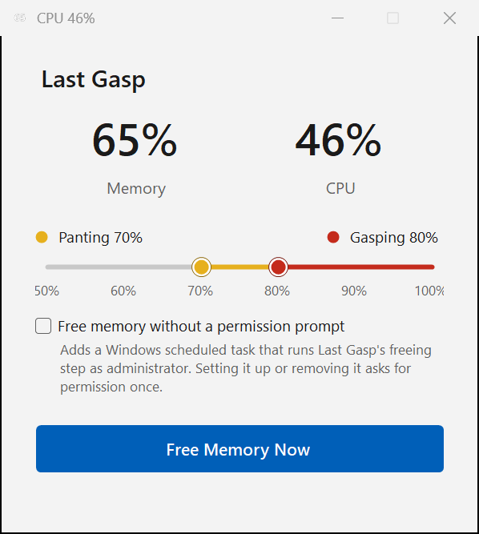

# Last Gasp

Last Gasp sits on your Windows taskbar and shows how much of your computer's memory is in use. When memory runs so low that the computer slows to a crawl, one click on its taskbar button frees memory, even when nothing else on the screen is responding.

## On the taskbar

The number on the icon is the percentage of memory in use. The label next to it shows how busy the processor is, the same figure that Task Manager shows.

| Taskbar button | What it means |
|---|---|
|  | **Normal.** Memory use is below your Panting level. |
|  | **Panting.** Memory use has reached your Panting level, so the icon turns yellow. |
|  | **Gasping.** Memory use has reached your Gasping level. The icon turns red and the label reads "Free Now". Click the button to free memory straight away, without opening a window. |

To see the label, Windows has to show labels on taskbar buttons. In Windows 11, open **Settings**, go to **Personalization > Taskbar > Taskbar behaviors**, and set **Combine taskbar buttons and hide labels** to **Never**. Without labels you still see the icon.

## The window

Click the taskbar button when memory isn't at the Gasping level to open Last Gasp's window.

- **Memory and CPU** show the current figures. The memory figure turns yellow or red to match the icon.
- **Panting and Gasping** set the levels at which the icon changes colour. Drag the yellow handle to set Panting and the red handle to set Gasping, anywhere from 50% to 100%. Last Gasp remembers them.
- **Free Memory Now** frees memory, whatever the current level.

## Freeing memory

Freeing memory asks Windows to take back memory that programs have set aside but aren't using right now, and to write out changes that are waiting to be saved to disk. Your programs keep running and nothing is lost. Each program reads back what it needs as it needs it.

Windows only lets an administrator do this, so by default Windows asks your permission each time you free memory.

If you'd rather not be asked every time, tick **Free memory without a permission prompt**. Last Gasp then sets up a Windows scheduled task that frees memory as administrator, and Windows asks your permission just once, to set it up. Untick the box to remove the task again, which also asks once. Bear in mind that while the task exists, a harmful program running under your account could replace Last Gasp with itself and have Windows run it as administrator without asking. Only tick the box on a computer where you trust what you run.

## Requirements

Last Gasp runs on Windows 11 and needs Microsoft's .NET 10 Desktop Runtime. If the runtime is missing, Windows offers to download it the first time you start Last Gasp.

## License

Last Gasp is free and open source under the [MIT License](LICENSE). Copyright © 2026 SIL Global.
